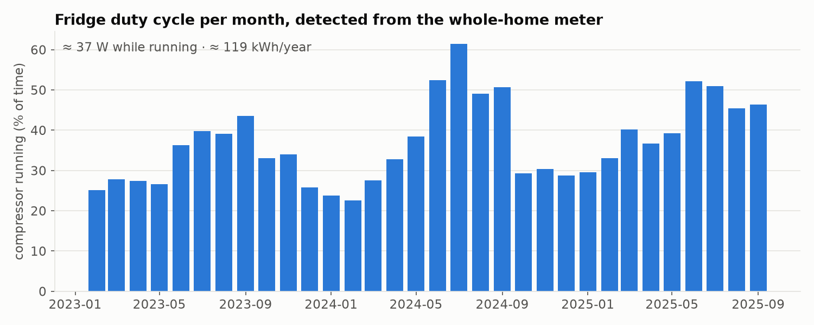
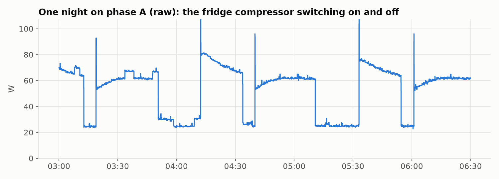
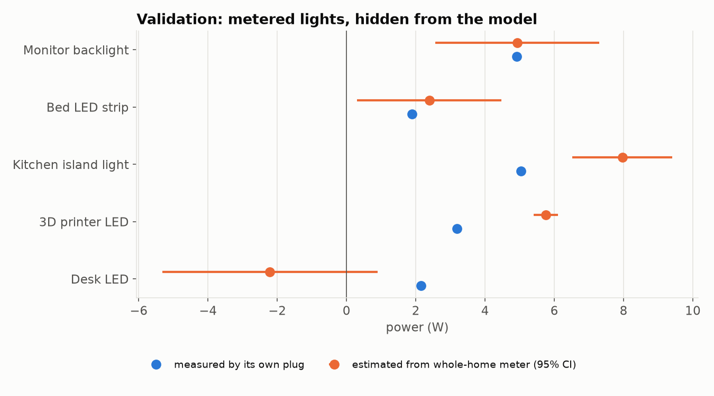
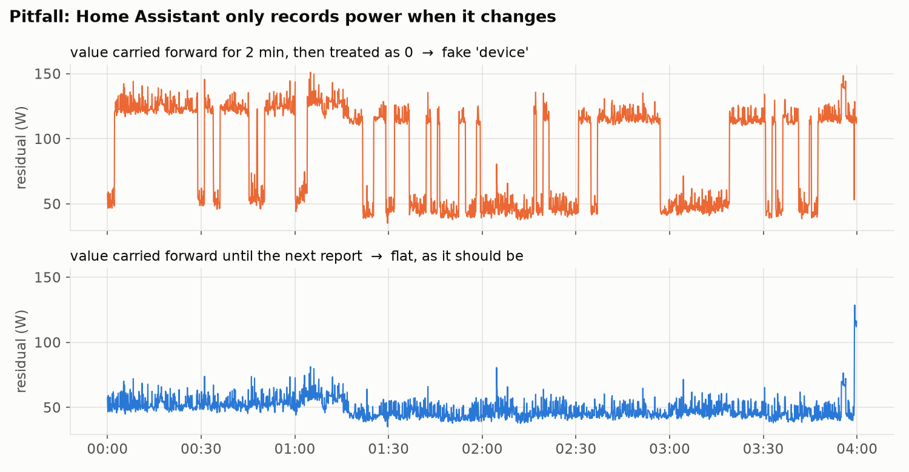

# Shadow Meter - research scripts

> These are the offline analysis scripts the Home Assistant app grew out of. They work directly on an
> InfluxDB export and are useful to explore your own data. For the app, see the [main README](../README.md).


**A shadow meter for every device that has no meter: find out how much power your *unmetered* devices use,
from the history Home Assistant already has.**

If Home Assistant records your whole-home power per phase (e.g. a Shelly 3EM) into InfluxDB, together
with a few smart plugs and the on/off state of your lights, that history is enough to estimate
devices that have no meter of their own: the fridge, the stove, ceiling lights, and so on.
This is called *non-intrusive load monitoring* (NILM).

`ha-shadow-meter` is a small set of Python scripts that

1. **analyse years of history** and estimate the power and energy of unmetered devices, and
2. run a **live service** that detects the fridge and the stove in real time and publishes them to Home
   Assistant as *virtual devices* via MQTT discovery (on/off, power, energy - usable in the Energy dashboard).

No extra hardware, no cloud, no machine-learning model that needs labelled training data.

## Example results (one apartment, 3.5 years of data)

| Device | How | Result |
|---|---|---|
| Fridge | compressor cycles in the residual | ≈ 37 W while running, **≈ 110-120 kWh/year**, duty cycle 22 % in winter to 61 % in summer |
| Stove (hob) | high load on two phases above the baseline | **≈ 215 kWh/year**, ~1,000 cooking sessions per year |
| Hallway light (motion sensor) | joint step regression | **21.1 ± 0.3 W** |
| Living-room scene (8 lights that always switch together) | joint step regression, as a group | 66 ± 1 W |
| Small LED lights (2-5 W) | joint step regression | ± 2-3 W - at the noise floor |



The fridge is easy to see in the raw data at night - every step is the compressor:



Validation: lights that *do* have their own plug are hidden from the model and estimated from the
whole-home meter, then compared with what their plug measured:



## How it works

```
InfluxDB ──export.py / export_states.py──▶ Parquet (data/)
                                             │
  steps.py        single light, step size at its switch events (quick first test)
  joint.py        all lights at once: robust regression over ~75,000 switch-event clusters
  phase_assign.py / stepphase.py   which phase is each metered device on?
  residual.py     residual = phase power − metered devices − estimated lights
  fridge.py / fridge_monthly.py    compressor cycles in the residual
  stove.py        high-load blocks on two phases, cooking sessions
                                             │
live/shadow_meter.py ──MQTT discovery──▶ Home Assistant: "Fridge (estimated)", "Stove (estimated)"
```

**Lights - joint step regression.** Each time a light switches, the whole-home power steps by its power.
One step is noisy (something else is always switching), but the median over thousands of events is
precise. The catch: lights rarely switch alone (scenes, automations), so the step is usually the sum of
several lights. `joint.py` therefore groups all switch events into clusters and solves, per phase,

    Δphase = Σ  w_light · s_light      (s = −1 / 0 / +1: net state change in the cluster)

with a Huber loss (robust to a kettle that happens to switch at the same moment), using only "clean"
clusters (stable power before/after, no metered device changing). Lights that always switch together
are merged into groups - only their sum can be identified. The sign of the per-phase coefficients also
tells you which phase each light is on.

**Residual.** Subtract every metered device (on its phase) and every estimated light from the phase power.
What is left belongs to unmetered devices.

**Fridge.** At night the residual is quiet. A fridge is a phase with regular switch-on steps of
30-60 W (including the inrush peak) and matching switch-off steps 10-50 minutes later. Pairing them gives
run time, pause and duty cycle per month, hence energy.

**Stove.** Hob plates draw 1-2.5 kW and cycle on/off at low settings. The stove shows up as load
> 500 W above a rolling baseline, on the two phases it is connected to, at meal times.

## Requirements

- Home Assistant with the **InfluxDB 1.x** integration (InfluxQL; 2.x is not supported yet).
- A whole-home meter **per phase** recorded every few seconds (Shelly 3EM, Shelly Pro 3EM, ...).
  Single-phase works too: just configure one phase.
- Light/switch state history in InfluxDB (lights must be included in the InfluxDB integration).
- Ideally some smart plugs - every metered device makes the residual cleaner, and metered lights are
  your ground truth for validation.
- Python ≥ 3.11. RAM: ~1.5 GB for the analysis (it works quarter by quarter), ~100 MB for the live service.

## Quick start

```bash
git clone https://github.com/martpp/ha-shadow-meter && cd ha-shadow-meter
python3 -m venv .venv && .venv/bin/pip install -r requirements.txt
cp config.example.yaml config.yaml          # adapt: database, phase entities, meters, ...
printf 'INFLUX_USER=shadowmeter\nINFLUX_PW=...\n' > ~/.shadow-meter-influx.env
chmod 600 ~/.shadow-meter-influx.env        # a read-only user is enough
```

InfluxDB read-only user (InfluxDB 1.x, as admin):

```sql
CREATE USER shadowmeter WITH PASSWORD '...'
GRANT READ ON "homeassistant" TO shadowmeter
```

Then run the pipeline (each step prints its results; outputs go to `out/`):

```bash
.venv/bin/python export.py --all                 # phases + meters -> data/W/*.parquet
.venv/bin/python export_states.py --all-lights   # light histories  -> data/state/*.parquet
.venv/bin/python diag_inventory.py               # sanity check: what was exported?
.venv/bin/python steps.py light.hallway          # quick test with a light that switches on its own
.venv/bin/python phase_assign.py                 # phase of each meter, per quarter
.venv/bin/python stepphase.py dishwasher_power   # ... or from its own steps (one meter per call)
.venv/bin/python joint.py                        # all lights -> out/lights.csv, out/validation.csv
.venv/bin/python residual.py                     # -> data/residual/<quarter>.parquet
.venv/bin/python fridge.py                       # which phase? which step sizes?
.venv/bin/python fridge_monthly.py a             # fridge per month and year
.venv/bin/python stove.py                        # stove sessions and kWh per year
.venv/bin/python make_figures.py fridge-seasonal # figures -> out/figures/
```

Go through the steps one by one and look at the output - every home is different, and the diagnosis
tools (`diag_*.py`) exist because the first residual is rarely right (see *Pitfalls*).

## Live service: fridge and stove in Home Assistant

`live/shadow_meter.py` reads the new values from InfluxDB every 10 s, keeps the last 3 hours in memory,
computes the residual and publishes two devices via MQTT discovery:

- **Fridge (estimated)**: `Running` (binary sensor), `Power`, `Energy` (kWh, `total_increasing`)
- **Stove (estimated)**: `Active`, `Power`, `Energy`

Configure the section `live:` in `config.yaml` (which meters to subtract on which phase, the fridge step
sizes and running power from your analysis, the stove thresholds) and put the MQTT credentials into
`~/.shadow-meter-mqtt.env` (`MQTT_HOST`, `MQTT_PORT`, `MQTT_USER`, `MQTT_PW`). Test it, then install it as a service:

```bash
SHADOW_METER_CONFIG=$PWD/config.yaml .venv/bin/python live/shadow_meter.py --dry-run
sudo cp live/shadow-meter.service /etc/systemd/system/   # adapt paths and user first
sudo systemctl enable --now shadow-meter
```

The service is limited to 400 MB RAM by systemd, so it can run next to InfluxDB on a small machine.

## Pitfalls (learned the hard way)

- **Home Assistant only records a value when it changes.** A plug that draws a constant 70 W may report
  only every few minutes. If you treat "no value" as 0 after a short time, the residual gets fake
  70 W on/off "devices". Carry values forward until the next report.
  
- **Not every meter is behind your main meter.** Devices in a garage, a basement or on another circuit
  never show up in the phases. `stepphase.py` finds them: ratio ≈ 0 on all phases. List them in
  `meters_not_behind_main`.
- **Phases change.** Devices get plugged into other sockets. `phase_assign.py` learns the phase per quarter.
- **Scenes.** Lights that always switch together can only be estimated as a group
  (`diag_coswitch.py` shows how often lights switch together).
- **Renamed and removed entities.** A lamp that was removed while "on" stays on forever unless its state
  is limited to the period in which the entity reports data (done in `common.light_state`).
- **Estimates that look like meters.** Sensors from Powercalc or devices that report their own nominal
  power have very few distinct values (`diag_inventory.py`) - don't use them as ground truth.
- **Groups and sums.** Light groups, PoE port sums, UPS output - never list a sum next to its parts.
- **RAM.** Years of 5 s data are large. Everything is float32 and computed quarter by quarter; run heavy
  steps with a memory limit (`systemd-run --scope -p MemoryMax=1600M ...`) on shared machines.
- **YAML.** `on:` and `off:` as keys are parsed as booleans. That's why the stove thresholds are `on_w`/`off_w`.

## Accuracy and limits

- Fridge energy: about ± 10-15 % (the live service may miss a cycle or catch a foreign 30-40 W step).
- Stove: low power levels with short pulses are underestimated; other large unmetered loads on the same
  phases (hair dryer, kettle) are counted as stove.
- Lights below ~5 W are at the noise floor (± 2-3 W).
- The method needs *history*: months, better years, of data at a resolution of a few seconds.

## License

MIT - see [LICENSE](LICENSE).
